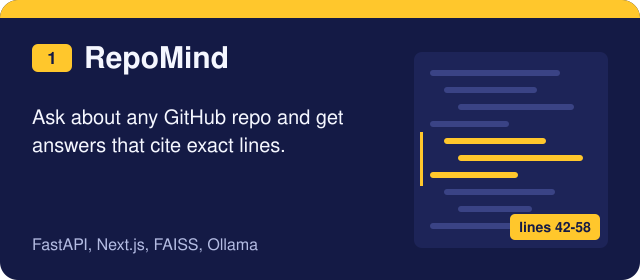
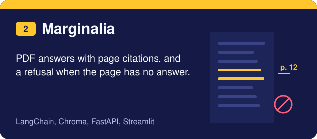
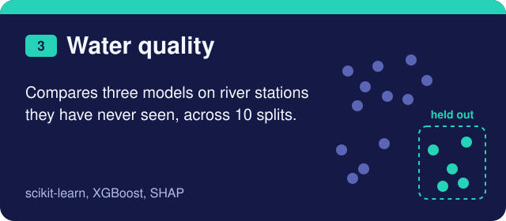
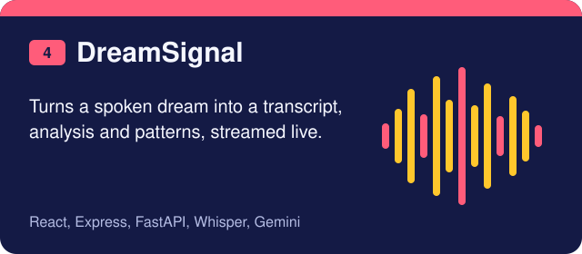
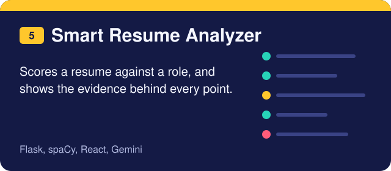
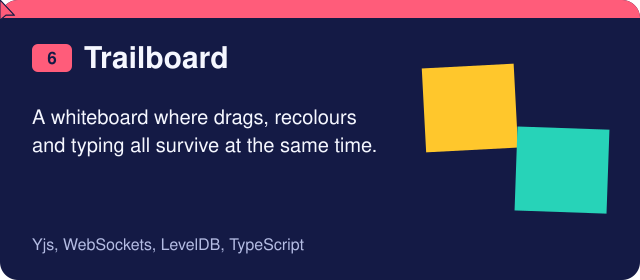
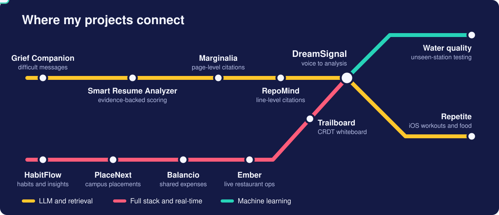

  
  
  
  

## Building now: Repetite

A workout log and food tracker in one iOS app, built with SwiftUI, HealthKit and SwiftData. Simple food logs go to Groq for speed and harder ones go to Gemini for accuracy. Coming soon to the App Store. [See the website](https://repetiteapp.github.io/repetite-app/).

  
  
  
  

## Selected work

The numbers match the citations at the top. Select a card to open the repo.

  
  
  
  
  
  

<b>The hardest bugs behind the top projects</b>

- **[RepoMind](https://github.com/octotat-bot/RepoMind):** vector search kept returning chunks from one file. A reranker with per-file diversity and identifier splitting lets other relevant files reach the model.
- **[Marginalia](https://github.com/octotat-bot/Marginalia):** small models wrote refusals with citations attached. A third guardrail turns those into real refusals with no sources.
- **[Water quality](https://github.com/octotat-bot/aml-dl-project):** random splits would mislead, so every model is tested on stations it has never seen, and feature leakage is labelled.
- **[Trailboard](https://github.com/octotat-bot/TrailBoard):** each note field is its own CRDT value, so one person can drag a note while another recolours it.

<b>More projects</b>

- [Grief Companion](https://github.com/octotat-bot/grief-companion): helps people write difficult messages
- [Ember](https://github.com/octotat-bot/ember): real-time restaurant operations
- [Balancio](https://github.com/octotat-bot/balancio): shared expenses with debt simplification
- [HabitFlow](https://github.com/octotat-bot/habitflow): habit tracking with mood analytics
- [PlaceNext](https://github.com/octotat-bot/PlaceNext): campus placement management
- [Ops-Pilot](https://github.com/octotat-bot/Ops-Pilot): approvals and internal requests
- [Personal-Portfolio](https://github.com/octotat-bot/Personal-Portfolio): scroll-driven portfolio site

## Tools I've shipped with

   
  

<b>LLM and retrieval:</b> LangChain, FAISS, Chroma, Ollama, Groq, Gemini <b>Machine learning:</b> scikit-learn, XGBoost, SHAP, spaCy, Whisper

## Contributions

Computer science at Newton School of Technology, graduating 2028. Completed a remote AI/ML internship at Mindenious in 2026.

